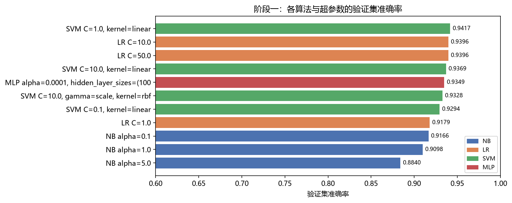
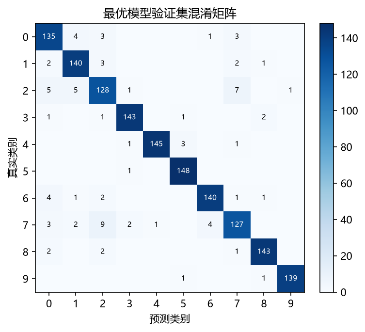

代码仓库：https://github.com/LyxCCBZ/AI_LAB

# 实验一 文本分类 实验报告

**课程**：当代人工智能　　**姓名**：刘宇轩　　**学号**：10245501443　　**日期**：2026 年 10 月

## 一、实验目的

1. 掌握文本分类的完整流程：数据划分、文本预处理、特征工程、模型训练、评估与预测。
2. 实践 TF-IDF 文本表示，理解高维稀疏特征对分类器选择的影响。
3. 掌握朴素贝叶斯、逻辑回归、线性 SVM 的原理与超参数含义，学会用验证集完成模型选择。

## 二、实验设置

**数据与划分**：20 Newsgroups 10 分类，有标签训练样本 7368 条、无标签测试样本 2457 条，各类 705~747 条，分布均衡。按分层抽样 8:2 划分为训练 5894 条、验证 1474 条，随机种子固定为 42；预测用的测试集在选型阶段完全不参与。

**特征工程**：分词后构造 TF-IDF，词频取 1+log(tf)，IDF 采用平滑形式，向量做 L2 归一化；词表与 IDF 只在训练集上拟合，验证集与测试集仅做变换，避免数据泄露。

**模型与超参数搜索**：多项式朴素贝叶斯（alpha=0.1 / 1 / 5）、softmax 逻辑回归（C=1 / 10 / 50）、线性 SVM（一对多平方铰链，C=0.1 / 1 / 10），并额外对比 RBF 核 SVM 与单隐层 MLP；评价指标为验证集准确率与 macro-F1。

本报告数值由随附的 `main.py` 运行得到（随机种子 42，约 7 分钟）。

## 三、实验结果

**表 1　算法与超参数（验证集，节选）**

| 模型 | 超参数 | 验证准确率 | macro-F1 |
| --- | --- | --- | --- |
| 线性 SVM | C = 1 | **0.9417** | 0.9417 |
| 逻辑回归 | C = 10 | 0.9396 | 0.9397 |
| 单隐层 MLP | 100 单元，300 轮 | 0.9349 | 0.9352 |
| RBF 核 SVM | C = 10 | 0.9328 | 0.9334 |
| 朴素贝叶斯 | alpha = 0.1 | 0.9166 | 0.9173 |

{w=3.4}

**表 2　TF-IDF 特征配置对比（模型固定为线性 SVM，C = 1）**

| 特征配置 | 词表规模 | 验证准确率 |
| --- | --- | --- |
| 基准 min_df = 2，max_features = 20000 | 20000 | **0.9417** |
| min_df = 1，max_features = 50000 | 50000 | 0.9417 |
| unigram + bigram | 50000 | 0.9376 |
| 不做 sublinear TF | 20000 | 0.9322 |
| max_features = 5000 | 5000 | 0.9206 |
| 去掉邮件头与引用行 | 20000 | 0.8582 |

**最终方案**：基准 TF-IDF（min_df=2、20000 维、sublinear、L2 归一化）+ 线性 SVM（C=1），在全部 7368 条有标签数据上重训后预测无标签测试集；各类预测 231~260 条，分布与训练集一致，泛化能力以验证集 0.9417 估计。

{w=2.4}

## 四、结果分析

1. **模型差异**：线性 SVM 最优（0.9417）且训练只需 1.1 秒；逻辑回归次之（0.9396）；单隐层 MLP（0.9349）与 RBF 核 SVM（0.9328）都低于线性模型，耗时却高出一到两个数量级；朴素贝叶斯用一次闭式统计在瞬间得到 0.9166，是性价比极高的基线。
2. **超参数影响**：朴素贝叶斯 alpha 越大越差（0.1→0.9166，5→0.8840），说明特征已归一化时不需要强平滑；逻辑回归 C=1 时欠拟合（0.9179），C 增大到 10 后达峰（0.9396）并趋于饱和；线性 SVM 在 C=1 处最优，C=0.1 欠拟合（0.9294）、C=10 反而回落（0.9369），说明间隔约束过强时边界易被噪声样本牵动。
3. **特征影响**：词表规模存在饱和点——从 20000 放开到 50000 维没有收益，压缩到 5000 维则下降 2.1 个百分点；加入 bigram 反而变差（稀疏度上升）；去掉 sublinear TF 下降约 1 个百分点；去掉邮件头与引用行暴跌 8.4 个百分点，说明邮件头本身携带类别信息，数据清洗必须以验证集效果为准。
4. **错误分析**：混淆集中在主题相近的类别之间（类别 7 有 9 条被判为类别 2），类别 2 与类别 7 的 F1 最低（0.868、0.876），其余类别都在 0.90 以上，类别 9 最高（0.989）。

## 五、思考

1. **SVM 与逻辑回归为何表现好**：TF-IDF 后数据是高维、稀疏、非负的向量，类别近似线性可分，少量判别性强的词即可决定分类；L2 正则与最大间隔目标又能压制噪声词，因此线性模型既准确又稳定。
2. **MLP 是否值得加深加宽**：实测单隐层 MLP 只有 0.9349，低于线性 SVM 的 0.9417，耗时却从 1 秒涨到 246 秒。2 万维输入层已是百万级参数，而训练样本仅 7 千余条，收益有限且过拟合风险高；若要使用，应保持小容量隐藏层并配合正则与早停。
3. **其他文本表示方法**：词袋与 n-gram、Hashing、LSA（TF-IDF + SVD 降维）、Word2Vec/GloVe/FastText、Doc2Vec，以及 BERT 等预训练表示的微调；词袋类方法效率高、可解释，在本任务中性价比最高。

## 六、结论与局限

**结论**：线性 SVM（C=1）配合基准 sublinear TF-IDF 与 L2 归一化取得最佳验证表现（准确率 0.9417、macro-F1 0.9417）；扩大词表、加入 n-gram 等改进均无收益，超参数与特征方案必须依据验证集选择。

**局限**：仅做单次 8:2 划分，0.5 个百分点以内的差异可能来自划分随机性；未做交叉验证；邮件头信息对性能贡献很大（去掉后降至 0.8582），若场景中只有正文，性能会明显下降。后续可做 5 折交叉验证与随机搜索、迭代伪标签、SVD 降维对比。
